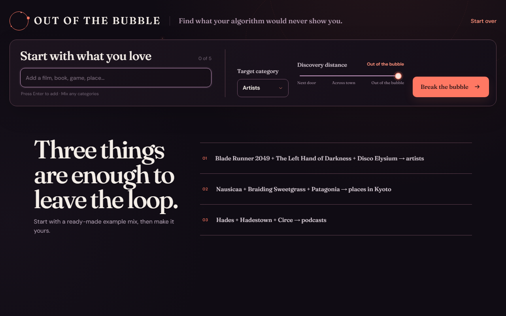
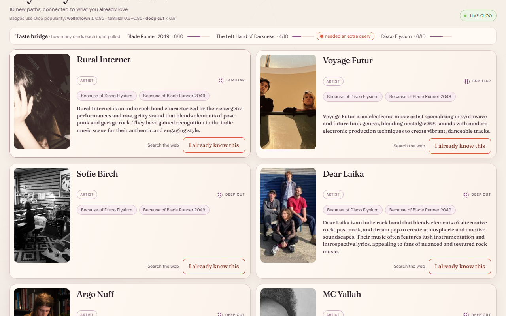
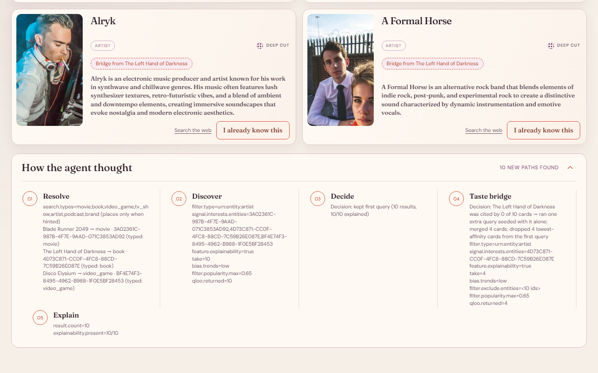
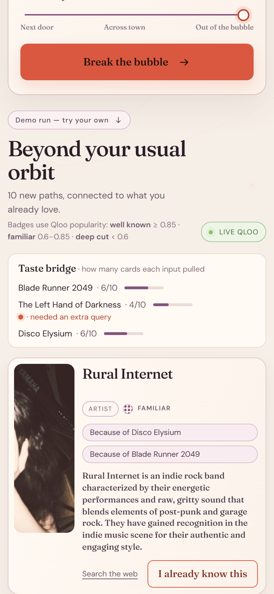

# Out of the Bubble

Out of the Bubble is a cross-category cultural discovery agent. Give it three to five things you love—a film, a book, a game, a brand, a place—and choose what you want to discover next. It asks Qloo for the bridges between those tastes, then deliberately walks beyond the usual recommendation loop.

The idea responds to a recurring frustration: people describe Spotify recommendations as too conservative and an “echo chamber,” say recommendations have declined since the early Discover Weekly era, and report that Spotify and YouTube keep leading them back to the same artists, genres, and moods. Sources: [Hacker News, September 2026](https://news.ycombinator.com/item?id=49797896), [Hacker News, August 2026](https://news.ycombinator.com/item?id=49173215), and [r/indieheads, June 2026](https://reddit.com/r/indieheads/comments/1ubrp0p/).

## Quick start

Node.js 20 or newer is required. The live site at <https://outofbubble.onrender.com> runs on real Qloo data. Locally, without `QLOO_API_KEY`, the app runs in mock mode on hand-written fictional fixtures, so you can develop and run the tests with no environment variables at all.

```bash
npm install
npm test
npm start
```

Open <http://localhost:3000>. In mock mode the first example mix loads automatically with fictional results (the badge reads "Sample data"). The three examples are always one click away in a small row under the input; **Start over** shows the larger empty state.

The deployed app is live at <https://outofbubble.onrender.com>. It runs on Render Free, so the first request after an idle period can take 50 seconds or more while the service wakes up. The page shows a wake-up notice, checks server health, and offers a retry if a request reaches the 65-second client timeout.

## Switching to the real Qloo API

Set this exact server-side environment variable:

```text
QLOO_API_KEY=your_qloo_api_key
```

PowerShell:

```powershell
$env:QLOO_API_KEY="your_qloo_api_key"; npm start
```

macOS/Linux:

```bash
QLOO_API_KEY="your_qloo_api_key" npm start
```

The key stays in the server process. The browser never receives it.

Optional LLM hooks:

```powershell
$env:QLOO_API_KEY="your_qloo_api_key"; $env:OPENAI_API_KEY="your_openai_api_key"; $env:OPENAI_MODEL="gpt-5-mini"; npm start
```

Without `OPENAI_API_KEY`, cards show only Qloo’s explanation. Discovery still works.

To exercise five fixed cross-category sets against the real API:

```powershell
$env:QLOO_API_KEY="your_qloo_api_key"; npm run smoke:real
```

The smoke script prints only a compact summary table and never writes Qloo output to disk.

## How it works

```text
Browser
  ├─ POST /api/resolve
  ├─ POST /api/discover
  └─ POST /api/exclude
          │
          ▼
  DiscoveryAgent
    Resolve → Discover → Decide → Taste bridge → Explain → (exclude) Refill
          │
          ├─ MockQlooClient (no QLOO_API_KEY)
          └─ HttpQlooClient (QLOO_API_KEY present)
                    │
                    ├─ GET /search
                    └─ GET /v2/insights
```

The Express server serves the API and the compiled vanilla TypeScript single page. `server/src/agent.ts` owns the complete loop and produces an in-memory trace that appears under **How the agent thought**. The Qloo clients share one interface, so tests run entirely against deterministic, hand-written fictional fixtures.

**Taste bridge.** After the first insights call the agent counts how many cards cite each input (Qloo explainability). If an input is cited by none (live, *The Left Hand of Darkness* gets 0 of 10 artist cards while the film and the game get 10 each), it runs one extra `/v2/insights` call seeded with that input alone (same type and distance parameters, `take=4`), merges those cards marked "Bridge from …", and drops the lowest-affinity first-page cards so the page stays at 10. The trace logs the decision either way, and a bar above the grid shows each input's share of the cards.

**Resolved-id reuse.** Once inputs have resolved, refills, slider moves and picker switches send `{ id, name, type }` back, so the server skips `/search` and the trace says "reused 3 resolved ids". A refill's trace is appended under the original run instead of replacing it.

### API routes

- `POST /api/resolve` resolves interest names (optionally `{ name, type }`) into entity IDs; with `alternatives: true` it also returns up to three other matches per input.
- `POST /api/discover` resolves inputs, maps discovery distance to Qloo controls, requests explainable insights (`take=10`), and returns up to 10 cards.
- `POST /api/exclude` excludes a known card plus the visible result set and refills with a fresh result.

## Why Qloo is load-bearing

Remove Qloo and the product loses its core capability. The app does not use Qloo as a decorative ranking pass over an existing catalog:

1. Qloo resolves mixed-category names into a common entity graph.
2. Qloo turns films, books, games, brands, and places into signals for a different target category.
3. Qloo’s insight filters implement discovery distance through trend, diversity, and popularity controls.
4. Qloo explainability is the only source of “Because of…” evidence; cards without a source say so plainly.
5. Qloo exclusions power the “already know it” refill loop.

The optional LLM writes only a short hook. It never selects, ranks, or explains the recommendation graph.

## Data & privacy

- The Qloo API key lives server-side only and is never exposed to the browser.
- No Qloo responses are stored in this repository.
- Only entity names, IDs, and tags are sent to Qloo—never personal data.
- Mock fixtures are hand-written fiction, not captured Qloo responses.

## Configuration

Copy `.env.example` into your deployment environment or set variables directly. The app does not load `.env` files itself, which avoids adding another runtime dependency; Render supplies configured values directly.

| Variable | Required | Default | Purpose |
|---|---:|---|---|
| `QLOO_API_KEY` | No | mock mode | Enables `HttpQlooClient` |
| `OPENAI_API_KEY` | No | disabled | Adds brief Responses API hooks |
| `OPENAI_MODEL` | No | `gpt-5-mini` | Responses API model |
| `PORT` | No | `3000` | Express listen port |

## Test coverage

Vitest (46 tests in 4 files) covers the type-aware resolver and its 4xx fallback, the decision step, both taste-bridge branches and its drop rule, resolved-id reuse, HTML-entity decoding and picker dedupe, badge thresholds, distance mapping and result-set differences, validation, deduplication, unresolved inputs, honest explanation-source rendering, exclusion, refill, card count, target typing, trace stages, and slow-request UI thresholds. Tests never call Qloo or OpenAI.

## Deploy to Render

1. Create a new Blueprint from this repository.
2. Render reads `render.yaml`, creates the `outofbubble` service, and builds the included Dockerfile.
3. Add `QLOO_API_KEY` as a secret environment variable.
4. Optionally add `OPENAI_API_KEY`.

The health check is `GET /api/health`.

## Screenshots

All four were captured from the live deployment (real Qloo data, "Live Qloo" badge) on 2026-10-27 at the default example (Blade Runner 2049 + The Left Hand of Darkness + Disco Elysium → artists, Out of the bubble). Light theme. 04 replays the live response captured for 02, so it cost no extra Qloo call.



*Empty state (1280x800): the example row under the input is always visible, and the same three example mixes are listed below it.*



*Live results at Out of the bubble. The taste-bridge bar shows each input's share of the 10 cards (Blade Runner 6, Left Hand of Darkness 4, Disco Elysium 6); The Left Hand of Darkness is flagged "needed an extra query" because no first-query card cited it, and its 4 cards carry "Bridge from The Left Hand of Darkness" chips. Every card has a Qloo image. The four bridge cards sit at the bottom of the list (see the next screenshot), below this frame.*



*The trace panel expanded: Resolve, Discover, Decide (kept first query), Taste bridge (0 of 10 cards cited the book, one extra query with its exact parameters including `filter.exclude.entities=<10 ids>`, 4 merged, 4 dropped) and Explain.*



*Same results at 390x844 @2x: single-column cards, the bridge bar stacked above them.*

## License

MIT
