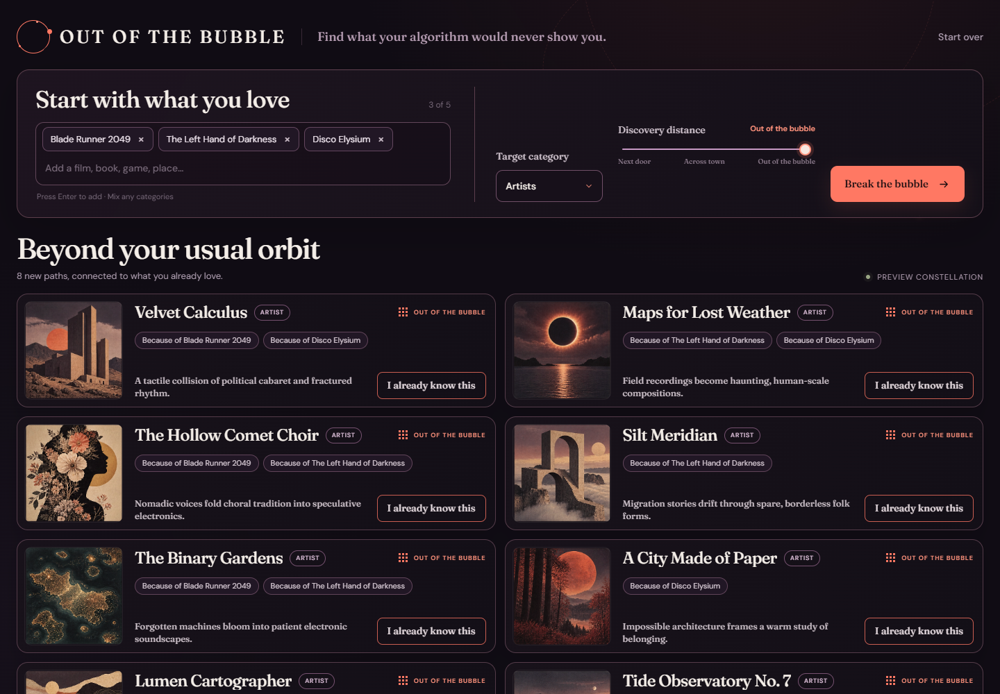
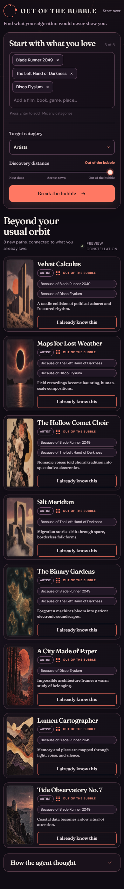

# Out of the Bubble

Out of the Bubble is a cross-category cultural discovery agent. Give it three to five things you love—a film, a book, a game, a brand, a place—and choose what you want to discover next. It asks Qloo for the bridges between those tastes, then deliberately walks beyond the usual recommendation loop.

The idea responds to a recurring frustration: people describe Spotify recommendations as too conservative and an “echo chamber,” say recommendations have declined since the early Discover Weekly era, and report that Spotify and YouTube keep leading them back to the same artists, genres, and moods. Sources: [Hacker News, September 2026](https://news.ycombinator.com/item?id=49797896), [Hacker News, August 2026](https://news.ycombinator.com/item?id=49173215), and [r/indieheads, June 2026](https://reddit.com/r/indieheads/comments/1ubrp0p/).

## Quick start

Node.js 20 or newer is required. No environment variables are needed for the complete mock experience.

```bash
npm install
npm test
npm start
```

Open <http://localhost:3000>. The first fictional constellation loads automatically. Click **Start over** to see the three empty-state examples.

The deployed app is live at <https://outofbubble.onrender.com>. It runs on Render Free, so the first request after an idle period can take 50 seconds or more while the service wakes up. The page shows a wake-up notice, checks server health, and offers a retry if a request reaches the 25-second client timeout.

## Switching to the real Qloo API

Set this exact server-side environment variable:

```text
QLOO_API_KEY=your_qloo_api_key
```

PowerShell:

```powershell
$env:QLOO_API_KEY="your_qloo_api_key"; npm start
```

macOS/Linux:

```bash
QLOO_API_KEY="your_qloo_api_key" npm start
```

The key stays in the server process. The browser never receives it.

Optional LLM hooks:

```powershell
$env:QLOO_API_KEY="your_qloo_api_key"; $env:OPENAI_API_KEY="your_openai_api_key"; $env:OPENAI_MODEL="gpt-5-mini"; npm start
```

Without `OPENAI_API_KEY`, cards show only Qloo’s explanation. Discovery still works.

To exercise five fixed cross-category sets against the real API:

```powershell
$env:QLOO_API_KEY="your_qloo_api_key"; npm run smoke:real
```

The smoke script prints only a compact summary table and never writes Qloo output to disk.

## How it works

```text
Browser
  ├─ POST /api/resolve
  ├─ POST /api/discover
  └─ POST /api/exclude
          │
          ▼
  DiscoveryAgent
    resolve → insights → explain → exclude + refill
          │
          ├─ MockQlooClient (no QLOO_API_KEY)
          └─ HttpQlooClient (QLOO_API_KEY present)
                    │
                    ├─ GET /search
                    └─ GET /v2/insights
```

The Express server serves the API and the compiled vanilla TypeScript single page. `server/src/agent.ts` owns the complete loop and produces an in-memory trace that appears under **How the agent thought**. The Qloo clients share one interface, so tests run entirely against deterministic, hand-written fictional fixtures.

### API routes

- `POST /api/resolve` resolves interest names into entity IDs.
- `POST /api/discover` resolves inputs, maps discovery distance to Qloo controls, requests explainable insights, and returns 8–10 cards.
- `POST /api/exclude` excludes a known card plus the visible result set and refills with a fresh result.

## Why Qloo is load-bearing

Remove Qloo and the product loses its core capability. The app does not use Qloo as a decorative ranking pass over an existing catalog:

1. Qloo resolves mixed-category names into a common entity graph.
2. Qloo turns films, books, games, brands, and places into signals for a different target category.
3. Qloo’s insight filters implement discovery distance through trend, diversity, and popularity controls.
4. Qloo explainability determines the “Because of…” evidence shown on every card.
5. Qloo exclusions power the “already know it” refill loop.

The optional LLM writes only a short hook. It never selects, ranks, or explains the recommendation graph.

## Data & privacy

- The Qloo API key lives server-side only and is never exposed to the browser.
- No Qloo responses are stored in this repository.
- Only entity names, IDs, and tags are sent to Qloo—never personal data.
- Mock fixtures are hand-written fiction, not captured Qloo responses.

## Configuration

Copy `.env.example` into your deployment environment or set variables directly. The app does not load `.env` files itself, which avoids adding another runtime dependency; Render supplies configured values directly.

| Variable | Required | Default | Purpose |
|---|---:|---|---|
| `QLOO_API_KEY` | No | mock mode | Enables `HttpQlooClient` |
| `OPENAI_API_KEY` | No | disabled | Adds brief Responses API hooks |
| `OPENAI_MODEL` | No | `gpt-5-mini` | Responses API model |
| `PORT` | No | `3000` | Express listen port |

## Test coverage

Vitest covers distance mapping, validation, deduplication, mock resolution, exclusion, refill, explanation-source rendering, card count, target typing, trace stages, and slow-request UI thresholds. Tests never call Qloo or OpenAI.

## Deploy to Render

1. Create a new Blueprint from this repository.
2. Render reads `render.yaml`, creates the `outofbubble` service, and builds the included Dockerfile.
3. Add `QLOO_API_KEY` as a secret environment variable.
4. Optionally add `OPENAI_API_KEY`.

The health check is `GET /api/health`.

## Screenshots

Captured from the mock-mode build during local browser QA:





Devpost capture placeholder: expanded agent trace.

## License

MIT
